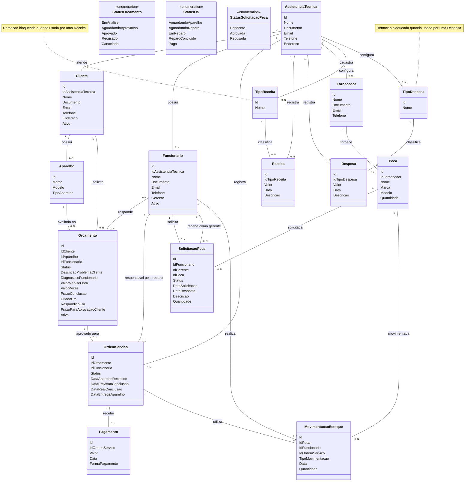

# Sistema de Assistência Técnica Ergon

## Objetivo

O sistema será usado por várias assistências técnicas independentes para gerenciar clientes, funcionários, orçamentos, ordens de serviço, pagamentos, fornecedores, peças, movimentações de estoque, receitas, despesas e relatórios.

Cada assistência terá seus próprios dados. Os relacionamentos entre registros devem manter os dados associados à assistência correspondente.

## Recorte da demonstração acadêmica local

Este documento preserva a **visão completa** do produto. Para a demonstração local da primeira versão, o escopo confirmado em `.specs/IDEIA.md` é:

- Cadastro e acesso de assistência e funcionários; cadastro de clientes e aparelhos.
- Solicitação, resposta, aprovação ou recusa de orçamentos; link enviado por email; criação da OS somente após aprovação; reparo, entrega e pagamento.
- Autenticação dos funcionários com **JWT** e recuperação de senha por email, confirmadas em 14/10/2026 e ainda pendentes de implementação.
- Isolamento dos dados entre assistências e preservação do histórico por desativação lógica.

Estoque, fornecedores, solicitação e movimentação de peças, receitas, despesas, tipos financeiros e relatórios permanecem na visão futura. As histórias `US06` a `US09` e `US11`, as regras correspondentes e as classes desses módulos **não são critérios de conclusão** da demonstração. As metas de desempenho, disponibilidade e backup `RNF07` a `RNF09` são propostas para uma etapa de implantação posterior, não resultados já comprovados.

O banco da demonstração permanece **PostgreSQL**. A interface troca JSON com a API Flask; Flask usa SQL para acessar o banco. Os conceitos dos slides orientam a implementação, que deve ser simples de explicar.

## Regras de assistência e usuários

- Cada assistência tem um ou mais funcionários.
- Clientes, funcionários, ordens de serviço, receitas, despesas, fornecedores e peças pertencem ao contexto de uma assistência.
- Existe uma única classe `Funcionario`. O atributo booleano `Gerente` define se o funcionário tem perfil de gerente.
- O gerente herda as funções de funcionário, exceto solicitar peça a outro gerente.
- O funcionário pode consultar o estoque, emitir relatórios simples, solicitar peças ao gerente e movimentar peças do estoque para uma OS.
- O gerente pode emitir relatórios simples e avançados, receber solicitações de peças, cadastrar fornecedores e peças, e cadastrar receitas e despesas.

## Clientes e aparelhos

- Um cliente pertence a uma assistência e pode ter um ou mais aparelhos.
- Um aparelho pertence a um cliente e pode estar associado a vários orçamentos ao longo do tempo.
- A solicitação online de orçamento deve permitir informar os dados do cliente, do aparelho e a descrição do problema ou serviço solicitado.
- O orçamento guarda a descrição do problema informada pelo cliente e o diagnóstico feito pelo funcionário.

## Fluxo de orçamento e criação da OS

- Uma OS só pode ser criada após a aprovação de um orçamento pelo cliente. Não há cadastro de OS independente de orçamento.
- Cada orçamento aprovado gera uma OS. Um orçamento ainda pendente, recusado ou cancelado não tem OS.
- O orçamento fica ligado ao cliente e ao aparelho. O funcionário que responde ao orçamento fica registrado para rastreabilidade.
- O funcionário responsável pelo reparo na OS pode ser diferente do funcionário que respondeu ao orçamento.
- Os campos `DescricaoProblemaCliente`, `DiagnosticoFuncionario`, `ValorMaoDeObra`, `ValorPecas` e `PrazoConclusao` pertencem ao orçamento. A OS consulta essas informações pela ligação com o orçamento; não as duplica.

### Formas de solicitar o orçamento

1. **Solicitação online pelo cliente:** o cliente solicita o orçamento; o funcionário analisa e responde; o cliente aprova ou recusa.
2. **Atendimento na loja com aprovação imediata:** o funcionário prepara o orçamento e o cliente o aprova na hora. A OS é criada após a aprovação.
3. **Atendimento na loja com análise posterior:** o funcionário cadastra o cliente, recebe o aparelho para análise, prepara o orçamento e o envia ao cliente. O cliente então aprova ou recusa.

### Prazos e status do orçamento

- `CriadoEm` registra a data em que o cliente solicitou o orçamento.
- `RespondidoEm` registra a data em que o funcionário respondeu com o orçamento.
- `PrazoParaAprovacaoCliente` é armazenado no banco de dados e corresponde a dois dias corridos para o cliente responder.
- Se o cliente aprovar, o orçamento recebe status `Aprovado` e a OS é criada.
- Se o cliente recusar, o orçamento recebe status `Recusado`, fica inativo e nenhuma OS é criada.
- Se o cliente não responder até o prazo, o orçamento recebe status `Cancelado` e fica inativo.
- O atributo `Ativo` do orçamento é booleano.
- Os status definidos para orçamento são: `EmAnalise`, `AguardandoAprovacao`, `Aprovado`, `Recusado` e `Cancelado`.

## Ordem de Serviço

- A OS é criada somente depois que o cliente aprova o orçamento.
- A OS tem um funcionário responsável pelo reparo; ele pode não ser o funcionário que respondeu ao orçamento.
- Após a aprovação, se a assistência ainda não recebeu o aparelho, a OS pode ficar em `AguardandoAparelho`. Quando o aparelho é recebido, passa a `AguardandoReparo`.
- Se o aparelho já estiver na assistência quando o orçamento for aprovado, a OS pode começar em `AguardandoReparo`.
- Os status definidos para OS são: `AguardandoAparelho`, `AguardandoReparo`, `EmReparo`, `ReparoConcluido` e `Paga`.
- A previsão de conclusão da OS pode mudar conforme a data em que o cliente entrega o aparelho, especialmente em orçamentos online.
- As datas da OS registram, em sequência, o recebimento do aparelho, a previsão de conclusão, a conclusão real do reparo e a entrega do aparelho ao cliente.

## Pagamento

- Cada OS pode ter no máximo um registro de pagamento.
- O registro de pagamento só é criado quando o cliente efetua o pagamento.
- A OS recebe status `Paga` após o pagamento ser finalizado.
- A classe `Pagamento` não tem atributo `Status`.

## Peças, fornecedores e estoque

- Cada peça está vinculada a um único fornecedor. O fornecedor pertence a uma assistência; assim, a assistência da peça é determinada por seu fornecedor.
- Uma peça pode ser usada em diferentes OS.
- Cada uso/retirada de peça é registrado em uma `MovimentacaoEstoque`, para rastrear a peça, a OS, o funcionário, a data, a quantidade e o tipo de movimentação.
- O funcionário registra a retirada da peça do estoque para uso em uma OS.
- Quando novas peças chegam, o gerente cadastra as peças diretamente pelo sistema. Não será criada agora uma movimentação de entrada para esse cadastro.
- Os campos `CriadoPor` e `CriadoEm` para registrar quem cadastrou a peça e quando foram considerados, mas não fazem parte do diagrama atual.
- Não foram adicionados novos tipos de movimentação de estoque; o atributo `TipoMovimentacao` permanece como definido no diagrama.

## Solicitação de peça

- Cada solicitação é feita por um funcionário para um gerente específico.
- Um funcionário pode fazer várias solicitações e um gerente pode receber várias solicitações.
- Cada solicitação se refere a uma peça e registra quantidade, descrição, data da solicitação, data da resposta e status.
- Os status de solicitação de peça são: `Pendente`, `Aprovada` e `Recusada`.

## Receitas, despesas e tipos

- Cada receita e despesa pertence a uma assistência.
- `TipoReceita` e `TipoDespesa` são classes cadastráveis, cada uma com `Id` e `Nome`; não são enumerações.
- Cada assistência recebe uma lista padrão de tipos de receita e despesa quando é criada.
- Cada assistência pode alterar seus tipos, adicionar novos e remover tipos que ainda não foram usados. As alterações de uma assistência não afetam as demais.
- A remoção de um tipo usado em uma receita ou despesa deve ser bloqueada, preservando a referência nos registros existentes.

## Status e tipos compartilhados

- Os status definidos no sistema são fixos e compartilhados entre as assistências.
- Os tipos de receita e despesa são específicos de cada assistência, partindo de uma lista padrão que pode ser personalizada.
- Os valores específicos de `TipoAparelho`, `FormaPagamento` e `TipoMovimentacao` não foram detalhados neste levantamento.

## Diagrama de classes

O diagrama abaixo foi mantido no mesmo formato, com os mesmos nomes, atributos, relações e cardinalidades definidos na versão anterior.

## 3. Stakeholders e Usuários

**Orientação:** (Identifique os principais stakeholders e usuários relacionados ao sistema. Para cada um, descreva seu papel, interesse ou relação com o projeto. Nem todo stakeholder necessariamente utilizará o sistema diretamente.)

| Stakeholder/usuário | Papel e relação com o projeto | Interesse/necessidade |
| --- | --- | --- |
| Proprietário ou responsável pela assistência técnica | Stakeholder responsável pela operação da assistência e pela adoção do sistema. | Acompanhar serviços, estoque e resultados financeiros da própria assistência; manter os dados separados dos de outras assistências. |
| Gerente da assistência | Usuário com perfil de gerente, implementado como funcionário com `Gerente = verdadeiro`. | Gerenciar funcionários e operação, responder solicitações de peças, cadastrar fornecedores e peças, registrar receitas e despesas e consultar relatórios simples e avançados. |
| Funcionário da assistência | Usuário operacional com `Gerente = falso`. | Consultar estoque, emitir relatórios simples, responder orçamentos, realizar reparos, movimentar peças para OS e solicitar peças a um gerente. |
| Cliente | Usuário externo que solicita orçamento online ou presencialmente e decide se aprova ou recusa a proposta. | Informar dados próprios, do aparelho e do problema; receber o orçamento e responder dentro do prazo; acompanhar o atendimento e pagar a OS. |
| Fornecedor | Parte externa que fornece peças à assistência. Não há indicação de acesso direto ao sistema. | Ter suas informações de fornecimento registradas e associadas às peças comercializadas para a assistência. |
| Equipe responsável pelo desenvolvimento e manutenção | Stakeholder técnico, sem papel operacional de negócio definido no modelo. | Implementar e manter os fluxos, regras de acesso, integridade e disponibilidade dos dados conforme os requisitos do projeto. |

## 4. Histórias de Usuário

**Orientação:** (Descreva as principais necessidades e funcionalidades do sistema utilizando histórias de usuário. Cada história deve seguir o formato: “Como [tipo de usuário], quero [necessidade], para [objetivo/benefício]. Cada história deve ter um identificador, US01. Cada história de usuário deve possuir um ou mais critérios de aceitação, descritos utilizando a estrutura Dado [contexto] / Quando [ação] / Então [comportamento]. Os critérios devem permitir verificar objetivamente se a história foi atendida.)

### US01 — Solicitar orçamento online

**Como** cliente, **quero** informar meus dados, os dados do aparelho e a descrição do problema ou serviço, **para** receber uma avaliação da assistência.

- **Dado** que estou no formulário de solicitação online, **quando** informo os dados necessários do cliente, do aparelho e do problema e envio a solicitação, **então** o sistema registra um orçamento em análise, associado ao cliente e ao aparelho, com a data de criação.
- **Dado** que já existe um cliente e um aparelho cadastrados na assistência, **quando** uma nova solicitação é registrada para esse aparelho, **então** o sistema permite associar novo orçamento ao mesmo aparelho sem apagar o histórico anterior.

### US02 — Cadastrar cliente e aparelho no atendimento

**Como** funcionário, **quero** cadastrar ou localizar o cliente e associar seu aparelho, **para** registrar um orçamento iniciado na loja.

- **Dado** que estou atendendo um cliente na loja, **quando** cadastro seus dados e um ou mais aparelhos, **então** cada aparelho fica associado ao cliente e ao contexto da assistência em atendimento.
- **Dado** que o aparelho já pertence ao cliente, **quando** registro outro orçamento para ele, **então** o sistema mantém o vínculo com o mesmo aparelho e o histórico de orçamentos.

### US03 — Analisar e responder orçamento

**Como** funcionário, **quero** registrar o diagnóstico, os valores e o prazo de conclusão e responder ao orçamento, **para** que o cliente possa decidir sobre o reparo.

- **Dado** um orçamento em análise, **quando** informo diagnóstico, mão de obra, peças e prazo de conclusão e envio a resposta, **então** o orçamento passa para `AguardandoAprovacao`, registra o funcionário responsável pela resposta e a data de resposta.
- **Dado** que o orçamento foi respondido, **quando** o sistema calcula o prazo para resposta do cliente, **então** registra um prazo de dois dias corridos a partir da resposta.

### US04 — Aprovar ou recusar orçamento

**Como** cliente, **quero** aprovar ou recusar o orçamento recebido, **para** autorizar ou não a execução do serviço.

- **Dado** um orçamento aguardando aprovação dentro do prazo, **quando** aprovo a proposta, **então** o orçamento recebe status `Aprovado` e é criada uma única OS vinculada a ele.
- **Dado** um orçamento aguardando aprovação, **quando** recuso a proposta, **então** o orçamento recebe status `Recusado`, fica inativo e nenhuma OS é criada.
- **Dado** um orçamento cujo prazo de dois dias corridos terminou sem resposta, **quando** o sistema processa o vencimento, **então** o orçamento recebe status `Cancelado`, fica inativo e nenhuma OS é criada.
- **Dado** que o orçamento já foi aprovado, recusado ou cancelado, **quando** uma nova resposta é enviada, **então** o sistema não cria outra OS nem altera a decisão já registrada.

### US05 — Gerenciar recebimento e reparo da OS

**Como** funcionário, **quero** acompanhar a OS e registrar o recebimento do aparelho e as etapas do reparo, **para** controlar a execução e a entrega do serviço.

- **Dado** que uma OS foi criada e o aparelho ainda não foi recebido, **quando** a OS é iniciada, **então** ela pode permanecer em `AguardandoAparelho`; ao registrar o recebimento, passa para `AguardandoReparo` e registra a data de recebimento.
- **Dado** que o aparelho já foi recebido quando o orçamento é aprovado, **quando** a OS é criada, **então** ela pode iniciar em `AguardandoReparo`.
- **Dado** que a OS está em execução, **quando** o funcionário inicia e conclui o reparo e registra a entrega, **então** o sistema registra as datas correspondentes e permite as transições de status previstas para a OS.
- **Dado** que o funcionário que respondeu ao orçamento não será o responsável pelo reparo, **quando** a OS é criada ou atribuída, **então** o sistema permite registrar outro funcionário como responsável.

### US06 — Consultar estoque e utilizar peça em OS

**Como** funcionário, **quero** consultar o estoque e registrar a retirada de uma peça para uma OS, **para** controlar o material aplicado no reparo.

- **Dado** que consulto o estoque da assistência, **quando** seleciono uma peça, **então** vejo a quantidade disponível pertencente àquela assistência.
- **Dado** que há quantidade suficiente da peça em estoque, **quando** registro sua retirada para uma OS, **então** o sistema registra peça, OS, funcionário, data, quantidade e tipo de movimentação, e atualiza a quantidade disponível.
- **Dado** que a quantidade solicitada é maior que a disponível, **quando** tento registrar a retirada, **então** o sistema rejeita a operação e não deixa o estoque negativo.

### US07 — Solicitar peça ao gerente

**Como** funcionário, **quero** solicitar uma quantidade de peça a um gerente específico, **para** obter autorização ou reposição necessária ao trabalho.

- **Dado** que sou funcionário e a peça está cadastrada, **quando** envio uma solicitação com gerente, peça, quantidade e descrição, **então** o sistema registra a solicitação como `Pendente`, com a data e a assistência correspondentes.
- **Dado** que sou gerente destinatário de uma solicitação pendente, **quando** aprovo ou recuso a solicitação, **então** o sistema registra o status escolhido e a data da resposta.
- **Dado** que sou funcionário sem perfil de gerente, **quando** tento responder a uma solicitação, **então** o sistema impede a ação.

### US08 — Cadastrar fornecedor e peças

**Como** gerente, **quero** cadastrar fornecedores e peças, **para** manter o catálogo e o estoque da assistência atualizados.

- **Dado** que estou cadastrado como gerente, **quando** cadastro um fornecedor, **então** ele fica vinculado à assistência em que estou atuando.
- **Dado** que existe um fornecedor da assistência, **quando** cadastro uma peça vinculada a ele com sua quantidade, **então** a assistência da peça é determinada pelo fornecedor e a quantidade passa a compor o estoque.
- **Dado** que tento cadastrar uma peça sem fornecedor válido da mesma assistência, **quando** salvo o cadastro, **então** o sistema rejeita a associação.

### US09 — Registrar receitas e despesas

**Como** gerente, **quero** registrar receitas e despesas usando tipos da minha assistência, **para** acompanhar os resultados financeiros da operação.

- **Dado** que seleciono um tipo de receita ou despesa, **quando** registro valor, data e descrição, **então** o lançamento fica associado à assistência e ao tipo selecionado.
- **Dado** que um tipo já foi usado por um lançamento, **quando** tento removê-lo, **então** o sistema bloqueia a remoção e mantém a referência dos lançamentos existentes.
- **Dado** que um tipo ainda não foi usado, **quando** o gerente o remove, **então** o sistema permite a remoção sem afetar tipos de outras assistências.

### US10 — Registrar pagamento da OS

**Como** funcionário, **quero** registrar o pagamento efetuado pelo cliente, **para** finalizar financeiramente a ordem de serviço.

- **Dado** que o cliente efetuou o pagamento de uma OS, **quando** registro valor, data e forma de pagamento, **então** o sistema cria um registro de pagamento associado à OS e altera seu status para `Paga`.
- **Dado** que uma OS já possui pagamento, **quando** tento registrar outro pagamento para ela, **então** o sistema impede a criação de um segundo registro.
- **Dado** que o pagamento ainda não foi efetuado, **quando** consulto a OS, **então** não existe registro de pagamento para ela.

### US11 — Emitir relatórios

**Como** funcionário ou gerente, **quero** emitir relatórios compatíveis com meu perfil, **para** acompanhar a operação da assistência.

- **Dado** que sou funcionário, **quando** solicito um relatório simples, **então** o sistema permite a emissão de relatório simples com dados da minha assistência.
- **Dado** que sou funcionário sem perfil de gerente, **quando** solicito um relatório avançado, **então** o sistema nega o acesso.
- **Dado** que sou gerente, **quando** solicito um relatório simples ou avançado, **então** o sistema permite a emissão com dados apenas da minha assistência.

### US12 — Entrar como funcionário com JWT (demonstração local)

**Como** funcionário, **quero** entrar com minhas credenciais e receber uma sessão JWT, **para** acessar somente os dados e ações permitidos na minha assistência.

- **Dado** um funcionário ativo com senha correta em uma assistência ativa, **quando** ele entra, **então** a API emite um JWT com prazo de validade definido.
- **Dado** um JWT ausente, alterado ou expirado, **quando** uma rota protegida é acessada, **então** a API nega o acesso.
- **Dado** um funcionário ou assistência desativado, **quando** o token é usado, **então** o acesso é negado mesmo que o prazo do JWT ainda não tenha terminado.
- O comportamento do logout e da invalidação de tokens existentes após a troca de senha ainda precisa ser definido antes da implementação.

### US13 — Recuperar senha por email (demonstração local)

**Como** funcionário, **quero** solicitar por email um link de recuperação, **para** definir uma nova senha quando perder o acesso.

- **Dado** um funcionário com email cadastrado, **quando** ele solicita recuperação, **então** o sistema envia um link individual ao endereço cadastrado sem revelar a senha anterior.
- **Dado** um link válido, **quando** o funcionário define uma nova senha, **então** a senha anterior deixa de funcionar e o link não pode ser reutilizado.
- **Dado** um link inválido ou vencido, **quando** ele tenta redefinir a senha, **então** a alteração é recusada.
- O prazo do link, a forma de identificar a assistência e a proteção contra descoberta de contas precisam ser fechados antes da implementação.

## 5. Requisitos Não-Funcionais

**Orientação:** (Descreva as qualidades ou restrições do sistema — como desempenho, segurança, usabilidade, compatibilidade, disponibilidade, entre outros - quando possível, mensuráveis/verificáveis. Evite termos subjetivos como “rápido”, “fácil”, “bonito” ou “seguro” sem definir como essa característica poderá ser verificada. Cada requisito deve ter um identificador, exemplo, RNF01.)

> As metas numéricas abaixo são propostas iniciais para tornar os requisitos verificáveis; devem ser confirmadas com os responsáveis pelo projeto antes da implantação.

Para a **demonstração local**, `RNF07` a `RNF09` não compõem o critério de conclusão: não há medição de carga, disponibilidade mensal ou rotina operacional de backup que permita afirmar seu atendimento. `RNF11` ainda exige decisão sobre usar um fuso único ou um fuso configurável por assistência.

- **RNF01 — Isolamento entre assistências:** Toda consulta ou alteração de clientes, funcionários, OS, receitas, despesas, fornecedores, peças e tipos deve restringir os resultados à assistência autenticada. A verificação deve comprovar que um usuário não consegue consultar nem alterar registros de outra assistência, inclusive manipulando identificadores enviados à aplicação.
- **RNF02 — Controle de acesso por perfil:** O sistema deve validar permissões no servidor em cada operação. Funcionários podem consultar estoque, emitir relatórios simples, solicitar peças e registrar movimentações para OS. Somente gerentes podem emitir relatórios avançados, responder solicitações como gerente e cadastrar fornecedores, peças, receitas e despesas. Tentativas não autorizadas devem ser negadas e não podem alterar dados.
- **RNF03 — Integridade referencial:** O sistema deve persistir relações válidas entre assistência, cliente, aparelho, orçamento, OS, funcionário, pagamento, peças, fornecedores e lançamentos. A tentativa de salvar uma referência inexistente ou incompatível com a assistência deve ser recusada sem persistência parcial.
- **RNF04 — Consistência transacional:** A aprovação de um orçamento e a criação da OS correspondente devem ocorrer como uma única operação lógica. Se qualquer etapa falhar, não deve permanecer uma aprovação sem OS nem uma OS sem orçamento aprovado. O mesmo princípio vale para registrar pagamento e alterar o status da OS.
- **RNF05 — Proteção de credenciais e tráfego:** Senhas e tokens usados somente para verificação não devem ser armazenados em texto puro; devem ser protegidos por hash apropriado. Outros campos sensíveis precisam ser classificados conforme a necessidade de recuperar seu valor, antes de escolher a proteção. Em produção, todo tráfego entre cliente e sistema deve usar HTTPS/TLS.
- **RNF06 — Rastreabilidade:** O sistema deve registrar, no mínimo, funcionário responsável pela resposta ao orçamento, responsável pelo reparo, e dados de cada movimentação de estoque (peça, OS, funcionário, data, quantidade e tipo), conforme o modelo. Registros devem permitir identificar a assistência e o momento da operação.
- **RNF07 — Desempenho (meta proposta):** Em condições normais de operação e até 50 usuários simultâneos, pelo menos 95% das consultas de listagem e gravações usuais devem responder em até 2 segundos, excluídas a geração de relatórios avançados e as operações dependentes de serviços externos. O tempo deve ser medido no ambiente de homologação com massa de dados representativa.
- **RNF08 — Disponibilidade (meta proposta):** O sistema deve alcançar disponibilidade mensal de pelo menos 99,5%, desconsiderando janelas de manutenção previamente comunicadas. A disponibilidade deve ser apurada por monitoramento automático do serviço.
- **RNF09 — Backup e recuperação (meta proposta):** Deve ser realizado backup automático pelo menos uma vez a cada 24 horas, com retenção mínima de 30 dias. Um teste trimestral de restauração deve demonstrar recuperação dos dados em até 8 horas e perda máxima de 24 horas de alterações.
- **RNF10 — Compatibilidade e interface:** A área de solicitação online deve funcionar nas versões estáveis atuais dos navegadores Chrome, Edge, Firefox e Safari para computador e dispositivos móveis. Formulários devem apresentar rótulos associados aos campos, mensagens de erro junto ao campo correspondente e permitir operação por teclado.
- **RNF11 — Datas e prazos:** Datas e horários devem ser armazenados de forma consistente e apresentados no fuso horário configurado para a assistência. O prazo de aprovação deve ser calculado como dois dias corridos a partir de `RespondidoEm`, sem substituição por dias úteis.

## 6. Regras de Negócio

**Orientação:** (Descreva as regras de negócio que o sistema precisa atender. Cada regra deve ter um identificador, exemplo, RN01.)

- **RN01 — Separação por assistência:** Cada assistência mantém seus próprios dados. Toda relação entre registros deve respeitar a assistência correspondente; registros de uma assistência não podem ser associados a registros de outra.
- **RN02 — Funcionários por assistência:** Cada assistência deve possuir um ou mais funcionários. O perfil de gerente é definido pelo atributo booleano `Gerente` da classe `Funcionario`; não existe classe separada de gerente.
- **RN03 — Permissões de funcionário e gerente:** Funcionários podem consultar estoque, emitir relatórios simples, solicitar peças a um gerente e movimentar peças do estoque para uma OS. Gerentes herdam as funções de funcionário, exceto solicitar peça a outro gerente, e também podem emitir relatórios avançados, receber solicitações, cadastrar fornecedores e peças e cadastrar receitas e despesas.
- **RN04 — Propriedade do cliente e aparelhos:** Cliente pertence a uma assistência e pode possuir um ou mais aparelhos. Cada aparelho pertence a um cliente e pode estar associado a vários orçamentos ao longo do tempo.
- **RN05 — Conteúdo do orçamento:** O orçamento deve estar ligado a um cliente e a um aparelho. Deve guardar a descrição do problema informada pelo cliente e o diagnóstico do funcionário, além dos valores de mão de obra e peças e do prazo de conclusão.
- **RN06 — Criação exclusiva da OS por aprovação:** Uma OS só pode ser criada após a aprovação de um orçamento pelo cliente. Não existe cadastro independente de OS. Cada orçamento aprovado gera uma OS; orçamento pendente, recusado ou cancelado não gera OS.
- **RN07 — Formas de atendimento:** O orçamento pode ser solicitado online pelo cliente, preparado na loja com aprovação imediata ou preparado na loja e enviado para análise posterior do cliente. Nos três fluxos, a OS depende da aprovação do orçamento.
- **RN08 — Rastreabilidade do orçamento:** O funcionário que responde ao orçamento deve ser registrado. Ele pode ser diferente do funcionário responsável pelo reparo da OS.
- **RN09 — Datas e prazo de resposta:** `CriadoEm` registra a solicitação do cliente; `RespondidoEm` registra a resposta do funcionário. `PrazoParaAprovacaoCliente` deve ser armazenado e corresponder a dois dias corridos para o cliente responder.
- **RN10 — Resultado da decisão do cliente:** A aprovação atribui status `Aprovado` e cria a OS. A recusa atribui status `Recusado`, torna o orçamento inativo e não cria OS. A ausência de resposta até o prazo atribui status `Cancelado`, torna o orçamento inativo e não cria OS. `Ativo` é booleano. Os estados permitidos são `EmAnalise`, `AguardandoAprovacao`, `Aprovado`, `Recusado` e `Cancelado`.
- **RN11 — Estados e datas da OS:** Após aprovação, a OS pode ficar em `AguardandoAparelho` se o aparelho ainda não foi recebido; ao recebê-lo, passa a `AguardandoReparo`. Se o aparelho já estiver na assistência, pode iniciar em `AguardandoReparo`. Os estados definidos são `AguardandoAparelho`, `AguardandoReparo`, `EmReparo`, `ReparoConcluido` e `Paga`. A OS registra recebimento, previsão de conclusão, conclusão real e entrega; a previsão pode ser ajustada conforme a data de entrega do aparelho pelo cliente.
- **RN12 — Dados do orçamento não duplicados na OS:** `DescricaoProblemaCliente`, `DiagnosticoFuncionario`, `ValorMaoDeObra`, `ValorPecas` e `PrazoConclusao` pertencem ao orçamento. A OS consulta esses dados pela relação com o orçamento e não os mantém duplicados.
- **RN13 — Pagamento da OS:** Cada OS pode ter no máximo um pagamento. O registro só é criado quando o cliente efetua o pagamento. Após o pagamento finalizado, a OS recebe status `Paga`. A classe `Pagamento` não possui atributo de status.
- **RN14 — Fornecedor, peça e estoque:** Cada peça está vinculada a um único fornecedor. O fornecedor pertence a uma assistência, que determina a assistência da peça. Uma peça pode ser usada em várias OS. O uso/retirada deve ser registrado em movimentação com peça, OS, funcionário, data, quantidade e tipo. O cadastro de novas peças pelo gerente atualiza o estoque diretamente; não gera movimentação de entrada neste escopo.
- **RN15 — Solicitação de peça:** Cada solicitação é feita por um funcionário a um gerente específico e se refere a uma peça. Deve registrar quantidade, descrição, data da solicitação, data da resposta e status. Um funcionário pode fazer várias solicitações e um gerente pode receber várias. Estados permitidos: `Pendente`, `Aprovada` e `Recusada`.
- **RN16 — Receitas e despesas:** Cada receita e despesa pertence a uma assistência e é classificada por um tipo cadastrável dessa assistência. `TipoReceita` e `TipoDespesa` possuem `Id` e `Nome` e não são enumerações.
- **RN17 — Tipos financeiros por assistência:** Ao ser criada, cada assistência recebe uma lista padrão de tipos de receita e despesa. A assistência pode alterar seus tipos, adicionar novos e remover tipos ainda não usados; essas alterações não afetam outras assistências. A remoção de tipo já usado deve ser bloqueada para preservar as referências existentes.
- **RN18 — Estados compartilhados e tipos configuráveis:** Os estados de orçamento, OS e solicitação de peça são fixos e compartilhados entre assistências. Tipos de receita e despesa são específicos por assistência. Os valores possíveis de `TipoAparelho`, `FormaPagamento` e `TipoMovimentacao` ainda não foram definidos no levantamento e precisam ser especificados antes da implementação dessas listas.
