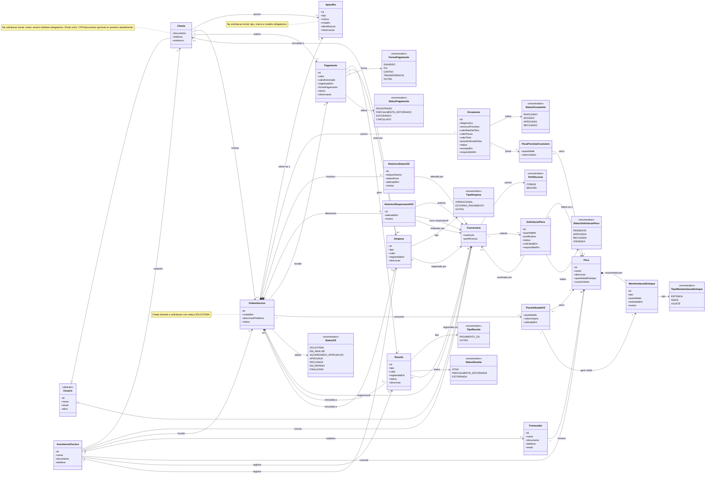

# Documentação do Diagrama de Classes — Sistema de Assistência Técnica Ergo - 1.0

## 1. Objetivo

Este documento descreve a organização do diagrama de classes do **Sistema de Assistência Técnica Ergon**. O modelo cobre os domínios de organização e acesso, atendimento técnico, financeiro, fornecedores e estoque.

A classe central é `AssistenciaTecnica`, que representa a empresa usuária do sistema e concentra seus cadastros, operações e lançamentos.

---

## 2. Visão geral dos domínios

| Domínio | Objetivo | Classes principais |
|---|---|---|
| Organização e acesso | Gerenciar a assistência, seus usuários e permissões. | `AssistenciaTecnica`, `Usuario`, `Cliente`, `Funcionario`, `PerfilAcesso` |
| Atendimento técnico | Controlar aparelhos, ordens de serviço, orçamentos e históricos. | `Aparelho`, `OrdemServico`, `Orcamento`, `HistoricoStatusOS`, `HistoricoResponsavelOS` |
| Financeiro | Registrar pagamentos, receitas, despesas e estornos. | `Pagamento`, `Receita`, `Despesa` |
| Fornecedores e estoque | Controlar peças, fornecedores, movimentações e solicitações. | `Fornecedor`, `Peca`, `MovimentacaoEstoque`, `SolicitacaoPeca` |

---

## 3. Organização e acesso

### `AssistenciaTecnica`

Representa a empresa de assistência técnica que utiliza o sistema.

**Atributos:**

- `id`
- `nome`
- `documento`
- `telefone`

**Relacionamentos:**

- Cadastra zero ou vários `Cliente`;
- Vincula um ou vários `Funcionario`;
- Recebe zero ou várias `OrdemServico`;
- Cadastra zero ou vários `Fornecedor`;
- Controla zero ou várias `Peca`;
- Registra zero ou várias `Receita` e `Despesa`.

### `Usuario`

Classe abstrata que concentra os atributos comuns de pessoas cadastradas no sistema.

**Atributos:**

- `id`
- `nome`
- `email`
- `ativo`

**Especializações:**

- `Cliente`
- `Funcionario`

### `Cliente`

O cliente pode ser cadastrado com dados basicos no momento da solicitacao da OS. Nessa etapa, nome, email e telefone sao obrigatorios. O email e obrigatorio e unico. O documento/CPF pode ser informado posteriormente, no cadastro completo.

Representa o cliente que solicita serviços para seus aparelhos.

**Atributos:**

- `documento`
- `telefone`
- `endereco`

**Relacionamentos:**

- Possui zero ou vários `Aparelho`;
- Solicita zero ou várias `OrdemServico`;
- Realiza zero ou vários `Pagamento`.

### `Funcionario`

Representa um colaborador da assistência técnica.

**Atributos:**

- `matricula`
- `perfilAcesso`

**Relacionamentos:**

- Possui um `PerfilAcesso`;
- Pode ser responsável por zero ou várias `OrdemServico`;
- Pode realizar alterações de status e responsável de uma OS;
- Pode registrar receitas, despesas e solicitações de peças.

### `PerfilAcesso`

Enumeração que define o nível de permissão do funcionário.

- `COMUM`
- `MASTER`

> Um gerente é representado por um `Funcionario` com perfil `MASTER`; não existe uma classe independente para gerente.

---

## 4. Atendimento técnico

### `Aparelho`

O aparelho e cadastrado no mesmo momento em que o cliente solicita a OS. Na solicitacao inicial, tipo, marca e modelo sao obrigatorios; os demais dados podem ser completados posteriormente.

Representa um aparelho pertencente a um cliente.

**Atributos:**

- `id`
- `tipo`
- `marca`
- `modelo`
- `identificacao`
- `observacao`

**Relacionamentos:**

- Pertence a um `Cliente`;
- É referenciado por uma `OrdemServico`.

### `OrdemServico`

Uma OS e criada durante a solicitacao de servico, depois que os dados basicos do cliente e do aparelho forem informados. A criacao inicial utiliza o status `SOLICITADA`.

Representa a solicitação e o acompanhamento do reparo de um aparelho.

**Atributos:**

- `id`
- `criadaEm`
- `descricaoProblema`
- `status`

**Relacionamentos:**

- Está vinculada a uma `AssistenciaTecnica`;
- É solicitada por um `Cliente`;
- Refere-se a um `Aparelho`;
- Possui um `Funcionario` responsável;
- Possui exatamente um `Orcamento`;
- Mantém históricos de status e de alteração de responsável;
- Pode receber vários pagamentos;
- Pode consumir várias peças.

### `StatusOS`

Enumeração do ciclo operacional da ordem de serviço.

- `SOLICITADA`
- `EM_ANALISE`
- `AGUARDANDO_APROVACAO`
- `APROVADA`
- `RECUSADA`
- `EM_REPARO`
- `FINALIZADA`

### `Orcamento`

Representa a proposta comercial associada a uma ordem de serviço.

**Atributos:**

- `id`
- `diagnostico`
- `servicosPrevistos`
- `valorMaoDeObra`
- `valorPecas`
- `valorTotal`
- `prazoEstimadoDias`
- `status`
- `enviadoEm`
- `respondidoEm`

**Relacionamentos:**

- Pertence a exatamente uma `OrdemServico`;
- Pode prever zero ou várias peças por meio de `PecaPrevistaOrcamento`.

### `StatusOrcamento`

- `RASCUNHO`
- `ENVIADO`
- `APROVADO`
- `RECUSADO`

### Históricos da ordem de serviço

| Classe | Finalidade |
|---|---|
| `HistoricoStatusOS` | Registra status anterior, novo status, data, motivo e funcionário que realizou a alteração. |
| `HistoricoResponsavelOS` | Registra funcionário anterior, novo responsável, autor da alteração, data e motivo. |

---

## 5. Financeiro

### `Pagamento`

Registra um pagamento informado manualmente no sistema.

**Atributos:**

- `id`
- `valor`
- `valorEstornado`
- `registradoEm`
- `formaPagamento`
- `status`
- `observacao`

**Relacionamentos:**

- É realizado por um `Cliente`;
- Está associado a uma `OrdemServico`;
- Gera exatamente uma `Receita`;
- Pode gerar zero ou várias `Despesa` de estorno.

### `Receita`

Representa uma entrada financeira da assistência técnica.

**Atributos:**

- `id`
- `tipo`
- `valor`
- `registradaEm`
- `status`
- `descricao`

**Relacionamentos:**

- Pertence a uma `AssistenciaTecnica`;
- Pode estar vinculada a uma `OrdemServico`;
- Pode ser gerada por um `Pagamento`;
- É registrada por um `Funcionario`.

### `Despesa`

Representa uma saída financeira.

**Atributos:**

- `id`
- `tipo`
- `valor`
- `registradaEm`
- `descricao`

**Relacionamentos:**

- Pertence a uma `AssistenciaTecnica`;
- Pode ser vinculada a um `Cliente` e a uma `OrdemServico`;
- Pode representar um estorno de pagamento;
- É registrada por um `Funcionario`.

### Enumerações financeiras

| Enumeração | Valores |
|---|---|
| `FormaPagamento` | `DINHEIRO`, `PIX`, `CARTAO`, `TRANSFERENCIA`, `OUTRA` |
| `StatusPagamento` | `REGISTRADO`, `PARCIALMENTE_ESTORNADO`, `ESTORNADO`, `CANCELADO` |
| `TipoReceita` | `PAGAMENTO_OS`, `OUTRA` |
| `StatusReceita` | `ATIVA`, `PARCIALMENTE_ESTORNADA`, `ESTORNADA` |
| `TipoDespesa` | `OPERACIONAL`, `ESTORNO_PAGAMENTO`, `OUTRA` |

### Regras financeiras

1. O registro de um `Pagamento` gera automaticamente uma `Receita`.
2. Um pagamento pode ser estornado parcialmente ou integralmente.
3. Cada estorno gera uma nova `Despesa` vinculada ao pagamento correspondente.
4. Pagamentos e receitas não devem ser removidos do histórico após cancelamento ou estorno.

---

## 6. Fornecedores e estoque

### `Fornecedor`

Representa a empresa ou pessoa responsável pelo fornecimento de peças.

**Atributos:**

- `id`
- `nome`
- `documento`
- `telefone`
- `email`

**Relacionamentos:**

- Pertence a uma `AssistenciaTecnica`;
- Fornece zero ou várias `Peca`.

### `Peca`

Representa um item controlado no estoque.

**Atributos:**

- `id`
- `nome`
- `descricao`
- `quantidadeEstoque`
- `custoUnitario`

**Relacionamentos:**

- Possui um `Fornecedor`;
- Mantém várias `MovimentacaoEstoque`;
- Pode aparecer em peças previstas de orçamento e em peças utilizadas em OS.

### Classes de associação de peças

| Classe | Finalidade |
|---|---|
| `PecaPrevistaOrcamento` | Registra uma peça prevista em um orçamento, com quantidade e valor unitário. Não altera o estoque. |
| `PecaUtilizadaOS` | Registra a peça efetivamente consumida em uma OS, com quantidade, valor unitário e data de uso. |

### `MovimentacaoEstoque`

Registra alterações no saldo de uma peça.

**Atributos:**

- `id`
- `tipo`
- `quantidade`
- `realizadaEm`
- `motivo`

Cada `PecaUtilizadaOS` gera uma `MovimentacaoEstoque` de saída.

### `SolicitacaoPeca`

Registra uma solicitação de peça feita por um funcionário.

**Atributos:**

- `id`
- `quantidade`
- `justificativa`
- `status`
- `solicitadaEm`
- `respondidaEm`

**Relacionamentos:**

- É solicitada por um `Funcionario`;
- Refere-se a uma `Peca`;
- Pode ser analisada por outro funcionário, normalmente com perfil `MASTER`.

### Enumerações de estoque

| Enumeração | Valores |
|---|---|
| `TipoMovimentacaoEstoque` | `ENTRADA`, `SAIDA`, `AJUSTE` |
| `StatusSolicitacaoPeca` | `PENDENTE`, `APROVADA`, `RECUSADA`, `ATENDIDA` |

### Regras de estoque

1. Uma peça prevista no orçamento não reduz a quantidade disponível.
2. Apenas o registro em `PecaUtilizadaOS` reduz o estoque.
3. A utilização de uma peça gera uma movimentação do tipo `SAIDA`.
4. O sistema deve impedir a utilização de uma peça quando a quantidade em estoque for insuficiente.

---

## 7. Relacionamentos e cardinalidades principais

| Origem | Cardinalidade | Destino | Descrição |
|---|---:|---|---|
| `AssistenciaTecnica` | 1 para 0..* | `Cliente` | Clientes cadastrados. |
| `AssistenciaTecnica` | 1 para 1..* | `Funcionario` | Funcionários vinculados. |
| `AssistenciaTecnica` | 1 para 0..* | `OrdemServico` | Ordens de serviço recebidas. |
| `Cliente` | 1 para 0..* | `Aparelho` | Aparelhos pertencentes ao cliente. |
| `Cliente` | 1 para 0..* | `OrdemServico` | Ordens solicitadas pelo cliente. |
| `Funcionario` | 1 para 0..* | `OrdemServico` | OS sob responsabilidade. |
| `OrdemServico` | 1 para 1 | `Orcamento` | Orçamento obrigatório da OS. |
| `OrdemServico` | 1 para 0..* | `Pagamento` | Pagamentos registrados. |
| `OrdemServico` | 1 para 0..* | `PecaUtilizadaOS` | Peças consumidas no reparo. |
| `Pagamento` | 1 para 1 | `Receita` | Receita gerada automaticamente. |
| `Pagamento` | 1 para 0..* | `Despesa` | Estornos associados. |
| `Fornecedor` | 1 para 0..* | `Peca` | Peças fornecidas. |
| `Peca` | 1 para 0..* | `MovimentacaoEstoque` | Histórico de movimentações. |

---

## 8. Herança e composição

### Herança

- `Cliente` herda de `Usuario`.
- `Funcionario` herda de `Usuario`.

### Composição

- `OrdemServico` compõe um `Orcamento`.
- `OrdemServico` compõe vários registros de `HistoricoStatusOS`.
- `OrdemServico` compõe vários registros de `HistoricoResponsavelOS`.
- `Peca` compõe várias `MovimentacaoEstoque`.

---

## 9. Código do diagrama Mermaid

