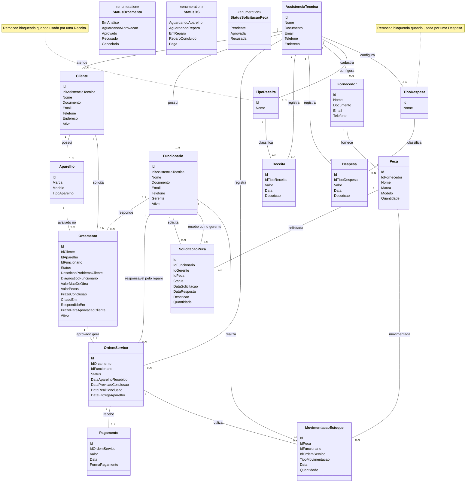

# Sistema de Assistência Técnica Ergon

## Objetivo

O sistema será usado por várias assistências técnicas independentes para gerenciar clientes, funcionários, orçamentos, ordens de serviço, pagamentos, fornecedores, peças, movimentações de estoque, receitas, despesas e relatórios.

Cada assistência terá seus próprios dados. Os relacionamentos entre registros devem manter os dados associados à assistência correspondente.

## Regras de assistência e usuários

- Cada assistência tem um ou mais funcionários.
- Clientes, funcionários, ordens de serviço, receitas, despesas, fornecedores e peças pertencem ao contexto de uma assistência.
- Existe uma única classe `Funcionario`. O atributo booleano `Gerente` define se o funcionário tem perfil de gerente.
- O gerente herda as funções de funcionário, exceto solicitar peça a outro gerente.
- O funcionário pode consultar o estoque, emitir relatórios simples, solicitar peças ao gerente e movimentar peças do estoque para uma OS.
- O gerente pode emitir relatórios simples e avançados, receber solicitações de peças, cadastrar fornecedores e peças, e cadastrar receitas e despesas.

## Clientes e aparelhos

- Um cliente pertence a uma assistência e pode ter um ou mais aparelhos.
- Um aparelho pertence a um cliente e pode estar associado a vários orçamentos ao longo do tempo.
- A solicitação online de orçamento deve permitir informar os dados do cliente, do aparelho e a descrição do problema ou serviço solicitado.
- O orçamento guarda a descrição do problema informada pelo cliente e o diagnóstico feito pelo funcionário.

## Fluxo de orçamento e criação da OS

- Uma OS só pode ser criada após a aprovação de um orçamento pelo cliente. Não há cadastro de OS independente de orçamento.
- Cada orçamento aprovado gera uma OS. Um orçamento ainda pendente, recusado ou cancelado não tem OS.
- O orçamento fica ligado ao cliente e ao aparelho. O funcionário que responde ao orçamento fica registrado para rastreabilidade.
- O funcionário responsável pelo reparo na OS pode ser diferente do funcionário que respondeu ao orçamento.
- Os campos `DescricaoProblemaCliente`, `DiagnosticoFuncionario`, `ValorMaoDeObra`, `ValorPecas` e `PrazoConclusao` pertencem ao orçamento. A OS consulta essas informações pela ligação com o orçamento; não as duplica.

### Formas de solicitar o orçamento

1. **Solicitação online pelo cliente:** o cliente solicita o orçamento; o funcionário analisa e responde; o cliente aprova ou recusa.
2. **Atendimento na loja com aprovação imediata:** o funcionário prepara o orçamento e o cliente o aprova na hora. A OS é criada após a aprovação.
3. **Atendimento na loja com análise posterior:** o funcionário cadastra o cliente, recebe o aparelho para análise, prepara o orçamento e o envia ao cliente. O cliente então aprova ou recusa.

### Prazos e status do orçamento

- `CriadoEm` registra a data em que o cliente solicitou o orçamento.
- `RespondidoEm` registra a data em que o funcionário respondeu com o orçamento.
- `PrazoParaAprovacaoCliente` é armazenado no banco de dados e corresponde a dois dias corridos para o cliente responder.
- Se o cliente aprovar, o orçamento recebe status `Aprovado` e a OS é criada.
- Se o cliente recusar, o orçamento recebe status `Recusado`, fica inativo e nenhuma OS é criada.
- Se o cliente não responder até o prazo, o orçamento recebe status `Cancelado` e fica inativo.
- O atributo `Ativo` do orçamento é booleano.
- Os status definidos para orçamento são: `EmAnalise`, `AguardandoAprovacao`, `Aprovado`, `Recusado` e `Cancelado`.

## Ordem de Serviço

- A OS é criada somente depois que o cliente aprova o orçamento.
- A OS tem um funcionário responsável pelo reparo; ele pode não ser o funcionário que respondeu ao orçamento.
- Após a aprovação, se a assistência ainda não recebeu o aparelho, a OS pode ficar em `AguardandoAparelho`. Quando o aparelho é recebido, passa a `AguardandoReparo`.
- Se o aparelho já estiver na assistência quando o orçamento for aprovado, a OS pode começar em `AguardandoReparo`.
- Os status definidos para OS são: `AguardandoAparelho`, `AguardandoReparo`, `EmReparo`, `ReparoConcluido` e `Paga`.
- A previsão de conclusão da OS pode mudar conforme a data em que o cliente entrega o aparelho, especialmente em orçamentos online.
- As datas da OS registram, em sequência, o recebimento do aparelho, a previsão de conclusão, a conclusão real do reparo e a entrega do aparelho ao cliente.

## Pagamento

- Cada OS pode ter no máximo um registro de pagamento.
- O registro de pagamento só é criado quando o cliente efetua o pagamento.
- A OS recebe status `Paga` após o pagamento ser finalizado.
- A classe `Pagamento` não tem atributo `Status`.

## Peças, fornecedores e estoque

- Cada peça está vinculada a um único fornecedor. O fornecedor pertence a uma assistência; assim, a assistência da peça é determinada por seu fornecedor.
- Uma peça pode ser usada em diferentes OS.
- Cada uso/retirada de peça é registrado em uma `MovimentacaoEstoque`, para rastrear a peça, a OS, o funcionário, a data, a quantidade e o tipo de movimentação.
- O funcionário registra a retirada da peça do estoque para uso em uma OS.
- Quando novas peças chegam, o gerente cadastra as peças diretamente pelo sistema. Não será criada agora uma movimentação de entrada para esse cadastro.
- Os campos `CriadoPor` e `CriadoEm` para registrar quem cadastrou a peça e quando foram considerados, mas não fazem parte do diagrama atual.
- Não foram adicionados novos tipos de movimentação de estoque; o atributo `TipoMovimentacao` permanece como definido no diagrama.

## Solicitação de peça

- Cada solicitação é feita por um funcionário para um gerente específico.
- Um funcionário pode fazer várias solicitações e um gerente pode receber várias solicitações.
- Cada solicitação se refere a uma peça e registra quantidade, descrição, data da solicitação, data da resposta e status.
- Os status de solicitação de peça são: `Pendente`, `Aprovada` e `Recusada`.

## Receitas, despesas e tipos

- Cada receita e despesa pertence a uma assistência.
- `TipoReceita` e `TipoDespesa` são classes cadastráveis, cada uma com `Id` e `Nome`; não são enumerações.
- Cada assistência recebe uma lista padrão de tipos de receita e despesa quando é criada.
- Cada assistência pode alterar seus tipos, adicionar novos e remover tipos que ainda não foram usados. As alterações de uma assistência não afetam as demais.
- A remoção de um tipo usado em uma receita ou despesa deve ser bloqueada, preservando a referência nos registros existentes.

## Status e tipos compartilhados

- Os status definidos no sistema são fixos e compartilhados entre as assistências.
- Os tipos de receita e despesa são específicos de cada assistência, partindo de uma lista padrão que pode ser personalizada.
- Os valores específicos de `TipoAparelho`, `FormaPagamento` e `TipoMovimentacao` não foram detalhados neste levantamento.

## Diagrama de classes

O diagrama abaixo foi mantido no mesmo formato, com os mesmos nomes, atributos, relações e cardinalidades definidos na versão anterior.

